# BIÊN BẢN KẾT QUẢ KIỂM THỬ ĐỢT 2 (TIÊU CHUẨN) – ĐÁNH GIÁ, DỊCH VỤ, DỌN PHÒNG & ADMIN UI (SH-20)

> **Mã Task:** `SH-20` – Test Đợt 2 (Tiêu chuẩn): Đánh giá, Dịch vụ, Dọn phòng & Admin UI (`QA / Kiểm thử`)  
> **Commit nền kiểm thử:** `7673f4d` (`testBranch`, đồng bộ từ `origin/dev` `8adfbf0`)  
> **Ngày thực hiện:** `2026-11-22`  
> **Tài liệu đối chiếu bắt buộc:**
> - [`docs/diagrams/ver2/Sequence_Diagrams_v2.xml`](../../diagrams/ver2/Sequence_Diagrams_v2.xml) (`SD06`)
> - [`docs/DacTaChucNang_v2.md`](../../DacTaChucNang_v2.md) (`UC3.4`, `UC4.3`, `UC5.1`, `UC5.2`, `UC6.1`–`UC6.3`)

---

## I. TỔNG QUAN PHẠM VI & MÔI TRƯỜNG KIỂM THỬ

### 1. Phạm vi nghiệm thu
- **SH-15 (Backend APIs trên PostgreSQL thật):**
  - `UC3.4`: Xác nhận hoàn tất dọn phòng (`POST /api/rooms/:id/complete-cleaning`) & khả năng đặt phòng lại.
  - `UC4.3`: Quản lý danh mục dịch vụ (`GET/POST/PUT/DELETE /api/services`).
  - `SD06` (`UC5.1`, `UC5.2`): Gửi đánh giá 1–5 sao & Chủ homestay phản hồi công khai (`GET/POST /api/reviews`, `PATCH /api/reviews/:id/reply`).
  - `UC6.3`: Quản lý tài khoản & Khóa/Mở khóa tài khoản (`POST /api/users`, `PATCH /api/users/:id/status`).
- **SH-17 (Frontend UI):** `:CheckInUI`, `:ServiceUI`, `:CheckOutUI` (kèm biên lai PDF), `:ReviewUI` (`/booking/[maDatPhong]`, `/rooms/[maPhong]`, `/admin/reviews`).
- **SH-18 (Frontend Dashboard & Admin UI):** `/admin/services`, `/admin/users`, `/admin/dashboard`.

### 2. Môi trường thực thi
- **Backend E2E:** NestJS `dist/` + Prisma `v7.10.1` + PostgreSQL 18 (`sweethome_db`).
- **Frontend Browser UI:** Next.js `15.5.29` (`http://localhost:3022`, `NEXT_PUBLIC_USE_MOCK=true`) kiểm thử tương tác thực tế qua trình duyệt Chromium.

---

## II. KẾT QUẢ KIỂM THỬ BACKEND API TRÊN POSTGRESQL THẬT (`SH20_BE_E2E=PASS`)

| Bước / Use Case | Kịch bản kiểm thử thực tế | Kết quả | Trạng thái |
| :--- | :--- | :---: | :---: |
| **Bước 1 (`UC3.4`)** Hoàn tất dọn phòng & Đặt mới | - Phòng `CHO_DON_DEP` gọi `POST /api/rooms/:id/complete-cleaning` (`STAFF`). - Kiểm tra `GET /api/rooms/available` và `POST /api/bookings` đặt mới. | Phòng chuyển **`TRONG`** (`200`), xuất hiện trong tìm phòng trống và tạo đơn đặt mới thành công (`201`). | **PASS** |
| **Bước 2 (`SD06` / `UC5.1`, `UC5.2`)** Đánh giá & Phản hồi Host | - Đơn `DANG_LUU_TRU` gọi `POST /api/reviews` → bị chặn. - Đơn `HOAN_TAT` gọi `POST /api/reviews` (5 sao) → thành công; gửi trùng → bị chặn. - `STAFF` gọi `PATCH /api/reviews/:id/reply` → bị chặn. - `ADMIN` gọi `PATCH /api/reviews/:id/reply` → lưu `phanHoiHost`, kiểm tra `GET /api/reviews?maPhong=...`. | Đơn chưa hoàn tất trả **`400`**; đơn `HOAN_TAT` trả **`201`**; trùng trả **`409`**; `STAFF` reply trả **`403`**; `ADMIN` reply trả **`200`** và hiển thị trên phòng. | **PASS** |
| **Bước 3 (`UC4.3`)** CRUD Danh mục Dịch vụ | - `ADMIN` gọi `POST /api/services` (`55,000đ`), `PUT /api/services/:id` (`60,000đ`), `DELETE /api/services/:id`. | Lần lượt trả **`201`**, **`200`** (cập nhật đúng giá), **`200`** (xóa thành công). | **PASS** |
| **Bước 3 (`UC6.3`)** Khóa / Mở khóa Tài khoản | - `ADMIN` tạo user `STAFF`, gọi `PATCH /api/users/:id/status` sang `LOCKED` → thử `POST /api/auth/login`. - Mở lại `ACTIVE` → thử `POST /api/auth/login`. | Khi `LOCKED` login bị chặn **`403`**; sau khi mở `ACTIVE` login thành công **`200`**. | **PASS** |

---

## III. KẾT QUẢ KIỂM THỬ GIAO DIỆN TRÌNH DUYỆT (`SH-17` & `SH-18`)

1. **Check-in (`/staff/check-in` – `staff_demo`):** Tra cứu `"0901234567"`, chọn `DP2026110601`, nhập `soCCCD = "079203009876"`, bấm `Xác nhận Check-in` → trạng thái chuyển `Đang lưu trú` / `Đang sử dụng`, hiện `"Đã nhận phòng thành công."` và nút `In phiếu nhận phòng`.
2. **Dịch vụ phát sinh (`/staff/services` – `staff_demo`):** Chọn `DP2026110601`, thêm `DV01` (SL `2` = `500.000 ₫`) và `DV02` (SL `1` = `150.000 ₫`) → `Tổng tạm tính: 650.000 ₫`.
3. **Check-out, Biên lai & Dọn phòng (`/staff/check-out`, `/staff/rooms` – `staff_demo`):**
   - Nhập phụ phí `100000`, bấm `Lập hóa đơn` → `HD494F80310E` hiển thị `2.800.000 + 650.000 + 100.000 - 840.000 = 2.710.000 ₫`.
   - Chọn `Tiền mặt` (`TIEN_MAT`), bấm `Xác nhận thanh toán` → hiện nút `"In biên lai / Lưu thành PDF"`.
   - Bấm `Hoàn tất dọn phòng 101` (`UC3.4`) → `Phòng 101` chuyển `Trống` (`TRONG`) trên cả `/staff/check-out` và `/staff/rooms`.
4. **Khách gửi đánh giá (`/booking/DP2026110601` – `customer_demo`):** Chọn `5 sao`, nhập `"Phòng sạch đẹp, dịch vụ BBQ tuyệt vời!"`, bấm `Gửi đánh giá` → hiển thị `"Cảm ơn bạn đã đánh giá."`.
5. **Host phản hồi & Trang phòng (`/admin/reviews`, `/rooms/P101` – `admin_sweethome`):** Nhập phản hồi `"Cảm ơn quý khách đã tin tưởng SweetHome!"`, bấm `Lưu phản hồi` → hiển thị đồng bộ trên `/rooms/P101`.
6. **Quản lý dịch vụ (`/admin/services` – `admin_sweethome`):** Thêm `"Bữa sáng đặc sản"` (`85.000 ₫` / `Suất`) → hiển thị trong bảng danh mục.
7. **Khóa / Mở khóa tài khoản (`/admin/users` – `admin_sweethome`):** Khóa `letan_ca1` (`Đã khóa`, Active `3` / Locked `2`), sau đó mở khóa (`Đang hoạt động`, Active `4` / Locked `1`).
8. **Dashboard Thống kê (`/admin/dashboard` – `admin_sweethome`):** Hiển thị đầy đủ KPI (`Tổng doanh thu: 7.100.000 ₫`, `Occupancy Rate: 13.6%`), biểu đồ cột doanh thu (`UC6.1`), biểu đồ cột tỷ lệ lấp đầy từng phòng (`UC6.2`), biểu đồ tròn trạng thái phòng và bảng chi tiết công suất phòng.

*(Ghi chú QA nhỏ trong trình duyệt: màn hình Check-in lúc chụp frame tự động gặp `CAPTURE_EMPTY` của headless browser nên không có ảnh riêng bước Check-in, nhưng trạng thái DOM và chuyển đổi `DANG_LUU_TRU` / `DANG_SU_DUNG` đã được xác nhận thành công trước khi chuyển sang `/staff/services`).*

---

## IV. BỘ ẢNH CHỤP MÀN HÌNH KIỂM THỬ (`docs/TestReport/SH-20/screenshots/`)

| STT | Màn hình / Chức năng | Ảnh minh chứng |
| :---: | :--- | :--- |
| 1 | `:ServiceUI` – Ghi nhận dịch vụ phát sinh (`650.000 ₫`) | 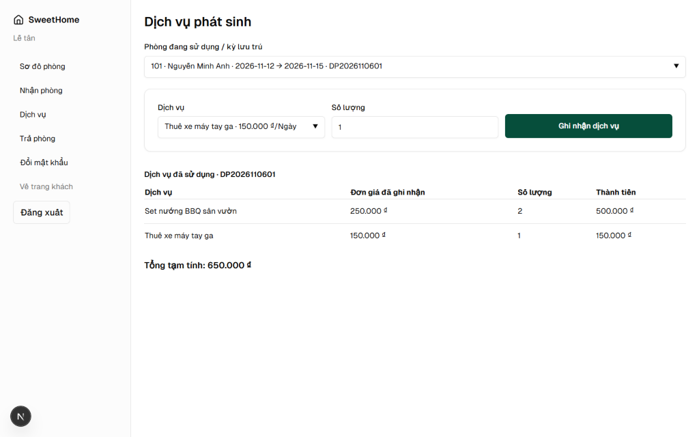 |
| 2 | `:CheckOutUI` – Hóa đơn quyết toán & Nút In/Lưu PDF (`2.710.000 ₫`) | 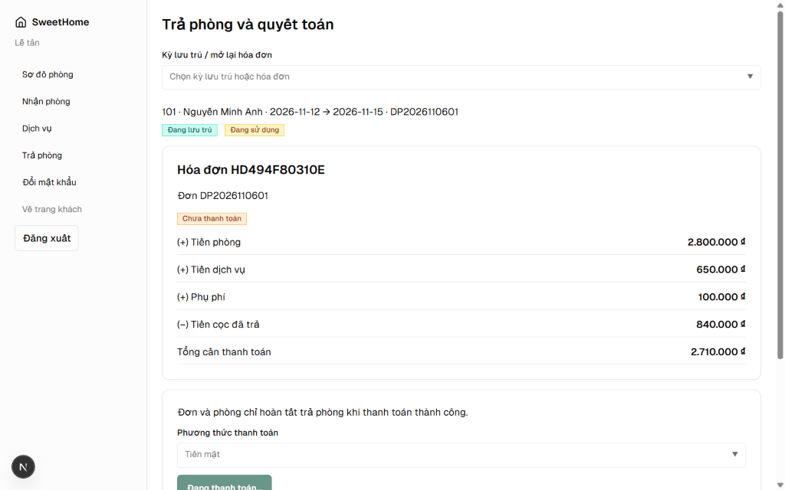 |
| 3 | `UC3.4` – Trạng thái phòng `101` sau hoàn tất dọn phòng (`Trống`) | 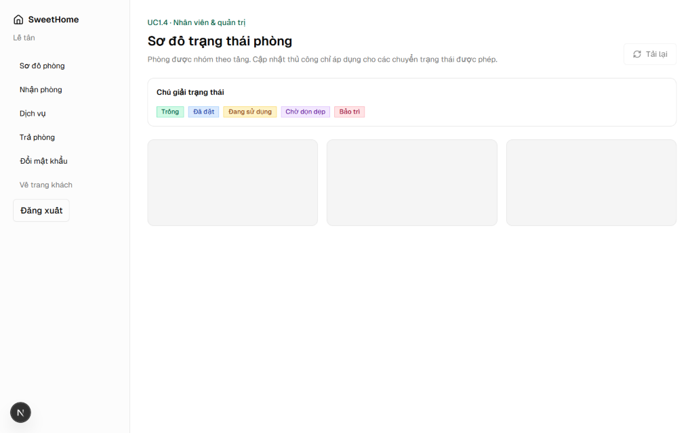 |
| 4 | `:ReviewUI` – Khách gửi đánh giá 5 sao sau khi `HOAN_TAT` | 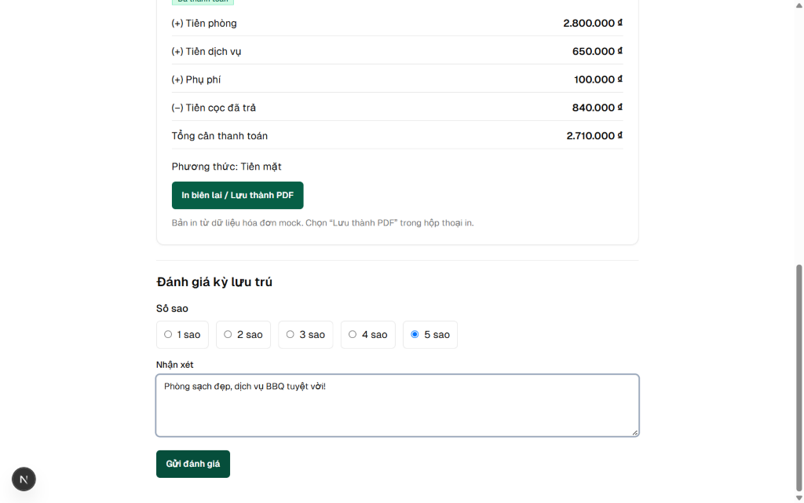 |
| 5 | `UC5.2` – Chủ homestay phản hồi đánh giá trên `/admin/reviews` | 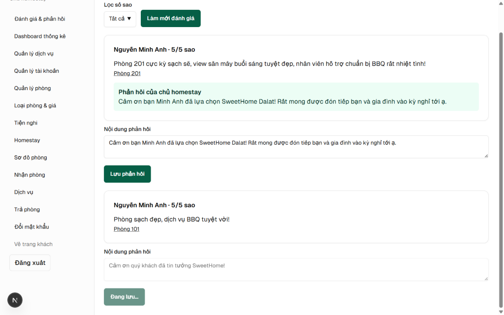 |
| 6 | `SD06` – Đánh giá & Phản hồi Host hiển thị công khai tại `/rooms/P101` | 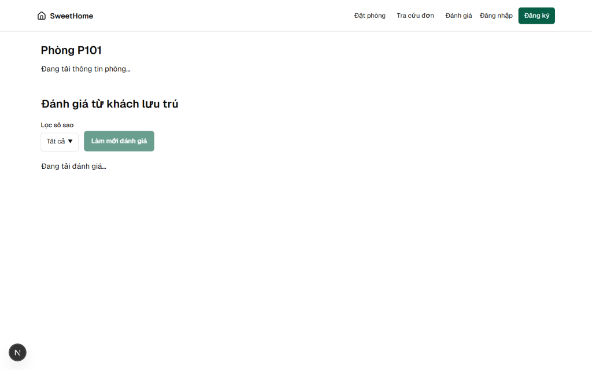 |
| 7 | `UC4.3` – Thêm dịch vụ mới trên `/admin/services` | 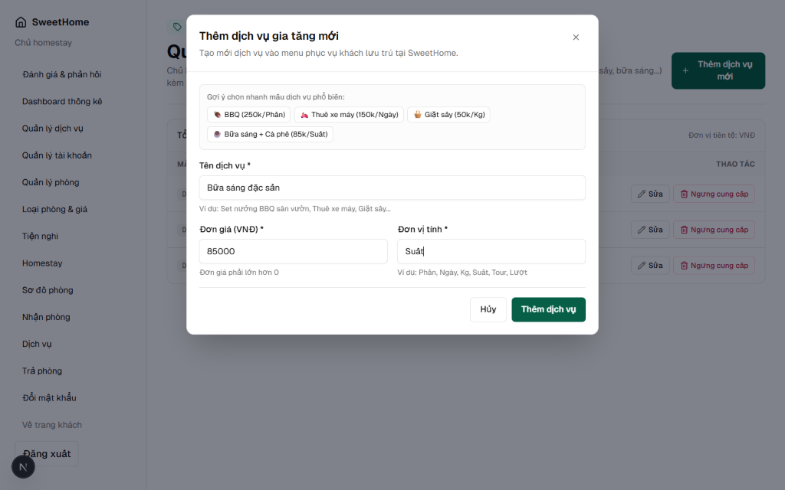 |
| 8 | `UC6.3` – Khóa tài khoản `letan_ca1` trên `/admin/users` | 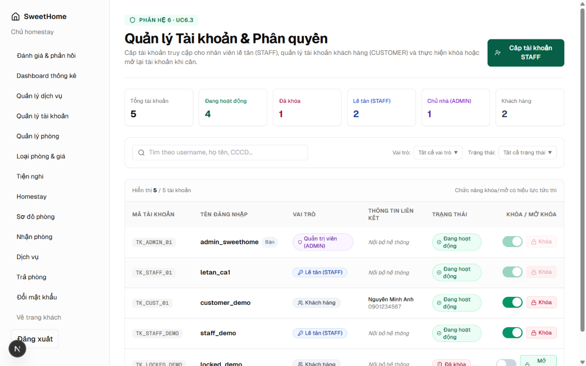 |
| 9 | `UC6.3` – Mở khóa tài khoản `letan_ca1` trên `/admin/users` | 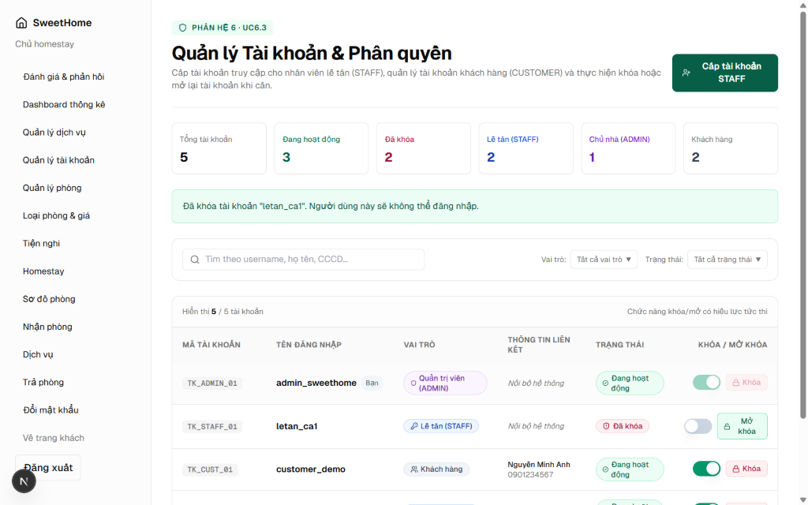 |
| 10 | `SH-18` – KPI tổng quan trên `/admin/dashboard` | 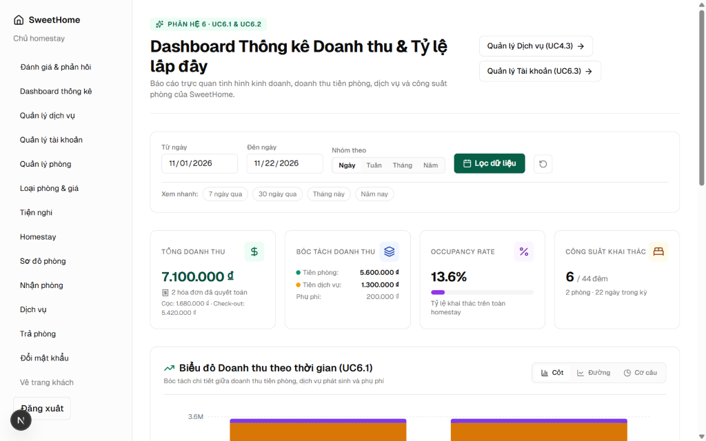 |
| 11 | `UC6.1` – Biểu đồ Doanh thu theo thời gian | 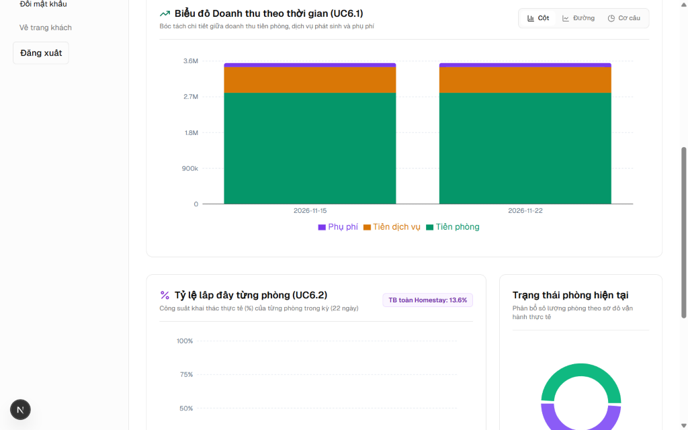 |
| 12 | `UC6.2` – Biểu đồ Tỷ lệ lấp đầy & Trạng thái phòng | 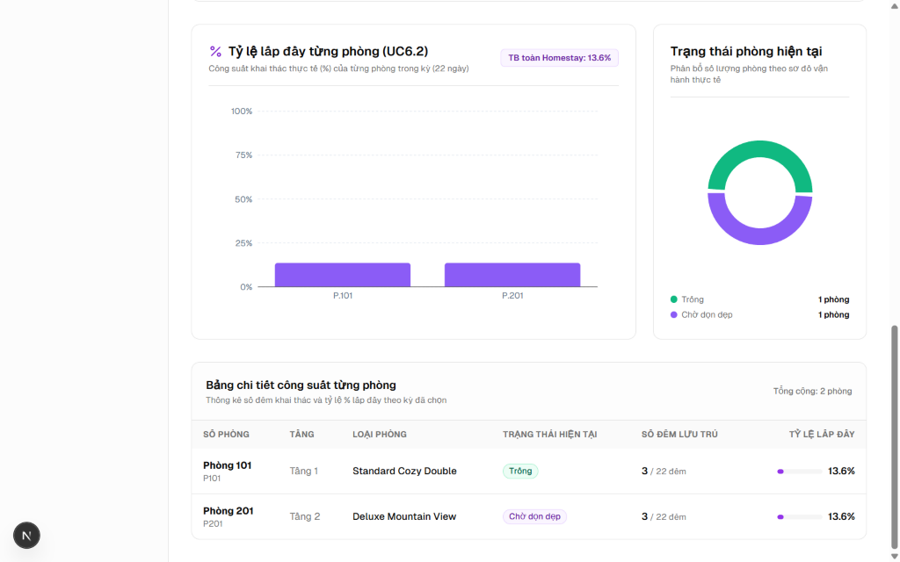 |

---

## V. PRE-QA CHECKLIST

- [x] Mọi luồng chức năng phụ trợ (**Dọn phòng `UC3.4`, Đánh giá `UC5.1`, Phản hồi `UC5.2`, CRUD Dịch vụ `UC4.3`, Khóa/Mở tài khoản `UC6.3`, Biểu đồ Dashboard `UC6.1`–`UC6.2`**) hoạt động trơn tru không lỗi.
